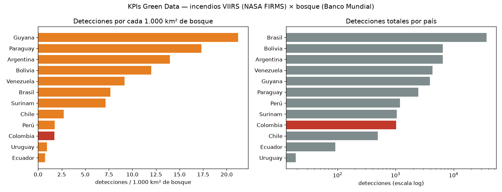

# Laboratorio 2 — Green Data: pipeline ETL Medallion de incendios forestales con Apache Airflow

**Curso:** Gestión de Proyectos de IA — Universidad Autónoma de Occidente
**Tema:** Green Data · **Entrega:** 21 de noviembre de 2026

Pipeline ETL en Python con arquitectura Medallion, orquestado con Apache Airflow, que **integra dos fuentes**:

| Fuente | Tipo | Contenido |
|---|---|---|
| [NASA FIRMS](https://firms.modaps.eosdis.nasa.gov/api/) (NASA Earthdata) | **API REST** (`requests`) | Incendios activos detectados por el sensor VIIRS (satélite NOAA-20) en Sudamérica |
| [Banco Mundial — Área de bosque](https://data.worldbank.org/indicator/AG.LND.FRST.K2) | **Archivo Excel** (`pandas`) | Área de bosque por país en km² (indicador `AG.LND.FRST.K2`) |
| [Natural Earth](https://www.naturalearthdata.com/) (apoyo) | GeoJSON | Límites de países, para asignar el país de cada incendio |

Las dos fuentes se **unen con un JOIN por país** en la capa Silver. La capa Gold produce **`gold_final.csv` con KPIs de negocio por país**, por ejemplo las detecciones de incendio por cada 1.000 km² de bosque. También se mantiene el flujo del Laboratorio 1 (CRISP-DM + TDSP + Scrum ML): al final se entrena un modelo.

```
Windows ─► WSL2 ─► Docker Desktop ─► Apache Airflow 3.3.2 ─► DAG incendios_firms_medallion

extraer_firms ─────────┐
  (API REST)           ├─► validar_bronze ─► transformar_a_silver ─► integrar_a_gold ─► cargar_datawarehouse ─► entrenar_modelo
extraer_excel_bosque ──┘     (calidad)       (limpieza + JOIN)      (KPIs, gold_final)   (SQLite estrella)       (LR vs RF)
  (Excel)
```

## Estructura

```
laboratorio-2/
├── incendios_etl/                 # Proyecto ETL + ML (equivale a "medallon" en la guía)
│   ├── config/config.yaml         # fuentes, región, reglas de calidad, parámetros del modelo
│   ├── data/
│   │   ├── referencia/            # Excel de bosque (respaldo) y límites de países
│   │   ├── bronze/                # datos originales: snapshots de la API y Excel descargado
│   │   ├── silver/                # detecciones limpias, bosque limpio y silver_integrado (JOIN)
│   │   ├── gold/                  # gold_final.csv (KPIs por país), detecciones y resumen diario
│   │   └── warehouse/             # incendios_dw.db (SQLite)
│   ├── src/
│   │   ├── extract/{extract_firms,extract_excel}.py
│   │   ├── transform/{validate_bronze,clean_firms,integrar_fuentes,gold_data,eda}.py
│   │   ├── load/load_datawarehouse.py
│   │   ├── model/train.py
│   │   └── pipeline.py            # una función por etapa (la usan main.py y el DAG)
│   ├── outputs/reports/           # métricas JSON y figuras
│   ├── tests/test_pipeline.py
│   └── main.py                    # ejecuta todo sin Airflow
├── airflow-incendios/             # Orquestador (equivale a "airflow-medallon")
│   ├── dags/incendios_etl_dag.py
│   ├── Dockerfile
│   ├── requirements-airflow.txt
│   ├── docker-compose.yaml        # oficial 3.3.2 + build . + montaje ../incendios_etl
│   └── .env.example
└── docs/
    ├── reporte_final.md
    └── scrum/                     # backlog, sprints, tablero, DoD, retrospectiva
```

## Ejecución

### Requisitos
Windows 10 2004+ / 11, WSL2, Docker Desktop con backend WSL2, mínimo 4 GB de RAM para Docker.

### 1. Con Airflow (flujo del laboratorio)

```powershell
cd airflow-incendios
copy .env.example .env          # opcional: agregar FIRMS_MAP_KEY
docker compose build
docker compose up airflow-init  # debe terminar con "exited with code 0"
docker compose up -d
```

Abrir http://localhost:8080 (usuario `airflow` / contraseña `airflow`), activar `incendios_firms_medallion` y pulsar **Trigger**. También se puede hacer desde la terminal:

```powershell
docker compose exec airflow-scheduler airflow dags list-import-errors
docker compose exec airflow-scheduler airflow dags trigger incendios_firms_medallion
docker compose exec airflow-scheduler airflow dags list-runs incendios_firms_medallion
```

El DAG está programado para las **06:00 UTC todos los días** (`schedule="0 6 * * *"`, `catchup=False`). La extracción reintenta 2 veces si falla la red.

### 2. Sin Airflow (desarrollo)

```powershell
cd incendios_etl
python -m venv .venv; .venv\Scripts\activate
pip install -r requirements.txt
python main.py                 # extrae + procesa
python main.py --sin-extraer   # reprocesa lo que ya hay en Bronze
python -m pytest -q tests
```

### Clave de la API FIRMS

El pipeline usa la **API de área de FIRMS**, que requiere una clave gratuita (*MAP_KEY*, se solicita en https://firms.modaps.eosdis.nasa.gov/api/map_key/). La clave permite 5.000 consultas cada 10 minutos y hasta 5 días por consulta. Cada integrante pone su propia clave en `airflow-incendios/.env` como `FIRMS_MAP_KEY=...`. **La clave es personal: `.env` está en `.gitignore` y nunca se sube al repositorio.** Si no hay clave, la extracción usa automáticamente el **feed público de 7 días**, que no requiere registro.

## Resultados (ejecución en Airflow del 14-nov-2026)

| | |
|---|---|
| Fuentes integradas | API REST de FIRMS + Excel del Banco Mundial (JOIN por país) |
| Detecciones únicas (7–14 nov 2026) | **65.734** en Sudamérica, de ellas 1.026 en Colombia |
| Cobertura del JOIN | 64.781 detecciones (98,5 %) con dato de bosque; el resto cae en el mar, Guayana Francesa o Centroamérica |
| Ejecuciones del DAG | 9 (8 manuales + 1 programada), todas `success` |
| Almacén | `fact_detecciones` 65.734 · `dim_pais` 12 · `kpi_pais` 12 · `dim_fecha` 8 · `agg_diario_celda` 4.836 |
| Regresión logística (baseline) | F1 macro **0,692** · accuracy 0,701 |
| Random Forest | F1 macro **0,940** · accuracy 0,977 · CV 0,938 ± 0,002 |
| Modelo recomendado | **Random Forest** (+0,24 F1, supera el margen mínimo de 0,01) |
| Reproducibilidad | Mismos datos → misma tabla Silver y mismas métricas en cada ejecución |

### KPIs por país (`gold_final.csv`)

| # | País | Bosque (km²) | Detecciones | Detecciones / 1.000 km² bosque | FRP / 1.000 km² bosque (MW) | % del total |
|---|---|---|---|---|---|---|
| 1 | Guyana | 183.772 | 3.897 | **21,21** | 180,6 | 6,0 |
| 2 | Paraguay | 142.974 | 2.477 | **17,32** | 231,3 | 3,8 |
| 3 | Argentina | 465.980 | 6.516 | 13,98 | 198,5 | 10,1 |
| 4 | Bolivia | 543.703 | 6.529 | 12,01 | 118,2 | 10,1 |
| 5 | Venezuela | 470.882 | 4.307 | 9,15 | 67,4 | 6,7 |
| 6 | Brasil | 4.860.866 | 37.191 | 7,65 | 75,5 | **57,4** |
| 7 | Surinam | 146.742 | 1.048 | 7,14 | 54,2 | 1,6 |
| 8 | Chile | 181.619 | 495 | 2,73 | 18,9 | 0,8 |
| 9 | Perú | 671.598 | 1.185 | 1,76 | 22,8 | 1,8 |
| 10 | **Colombia** | 594.569 | 1.026 | 1,73 | 10,4 | 1,6 |
| 11 | Uruguay | 20.240 | 19 | 0,94 | 5,8 | 0,03 |
| 12 | Ecuador | 123.103 | 91 | 0,74 | 4,2 | 0,1 |

Brasil concentra el 57 % de las detecciones. Sin embargo, al relativizar por su área de bosque, **Guyana y Paraguay** sufren la mayor presión del fuego. Colombia está entre los países con menor presión de la semana.



El análisis completo está en [docs/reporte_final.md](docs/reporte_final.md).

## Equipo y roles Scrum

| Rol | Integrante | Responsabilidades |
|---|---|---|
| Product Owner | Edgar Adrian Ortiz | Define objetivos, prioriza el backlog, valida la entrega final |
| Scrum Master | Osvaldo Emilio Marin | Coordina reuniones, mantiene el tablero, README y flujo Git |
| Data Engineer / Analyst | Nilson Jacobo Gonzales | Descarga, calidad, limpieza y EDA |
| ML Engineer | Juan Andrés Ruiz | Entrenamiento, evaluación y despliegue del modelo |
