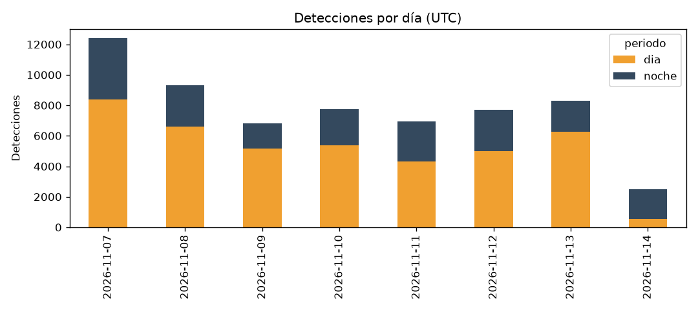

# Reporte final: detecciones de incendios forestales con NASA FIRMS y Apache Airflow

**Laboratorio 2:** CRISP-DM + TDSP + Scrum ML, orquestado con Apache Airflow (arquitectura Medallion)
**Curso:** Gestión de Proyectos de IA, Universidad Autónoma de Occidente
**Fecha de ejecución:** 14 de noviembre de 2026

---

## 1. Comprensión del negocio

Las autoridades ambientales y de gestión del riesgo (en Colombia: IDEAM, UNGRD y las CAR) vigilan los focos de calor que detectan los satélites para priorizar la respuesta a incendios. NASA publica estas detecciones casi en tiempo real en **FIRMS** (*Fire Information for Resource Management System*), un servicio de NASA Earthdata.

Cada detección trae un **nivel de confianza** (baja, nominal o alta). Una detección de confianza baja puede ser un falso positivo, por ejemplo un reflejo solar. Las de confianza alta casi siempre son fuegos intensos.

El proyecto tiene dos objetivos:

1. **Ingeniería de datos (eje del Laboratorio 2):** construir un pipeline reproducible y programado que descargue los datos de la API todos los días, los limpie, los integre y los cargue en un almacén para análisis. Orquestarlo con Airflow.
2. **Modelo (continuidad del Laboratorio 1):** clasificar el nivel de confianza de cada detección a partir de sus variables radiométricas y de contexto.

- **Tipo de problema:** clasificación supervisada multiclase (3 clases).
- **Métrica de éxito:** F1 macro, para que la clase minoritaria "baja" pese igual que las demás. Se complementa con accuracy y errores por clase.
- **Regla de decisión (heredada del Lab 1):** si el modelo complejo no supera al baseline por al menos **0,01 de F1 macro**, se prefiere el más simple.

## 2. Comprensión de los datos

**Fuente:** NASA FIRMS, sensor VIIRS a bordo del satélite NOAA-20 (producto `VIIRS_NOAA20_NRT`, resolución de 375 m), región Sudamérica.

| Aspecto | Resultado |
|---|---|
| Periodo | 7 al 14 de noviembre de 2026 (UTC) |
| Detecciones | 61.689 únicas (1.703 dentro de la caja de Colombia) |
| Variables originales | 13: `latitude`, `longitude`, `bright_ti4`, `bright_ti5`, `scan`, `track`, `acq_date`, `acq_time`, `satellite`, `confidence`, `version`, `frp`, `daynight` |
| Nulos | 0 en las columnas clave |
| Clases | nominal 54.913 (89 %) · baja 4.378 (7,1 %) · alta 2.398 (3,9 %) |
| Desbalance | ≈ 23:1 entre la clase mayor y la menor |
| Día / noche | 67,5 % / 32,5 % |
| FRP (potencia radiativa, MW) | mediana 5,2 · media 9,9 · máx. 709,6 (distribución muy sesgada) |

**Hallazgos clave del análisis exploratorio:**

- **El 100 % de las detecciones de confianza "alta" tiene el canal I4 saturado (367 K).** Ninguna detección "nominal" está saturada. Esto coincide con la documentación del algoritmo VIIRS: un píxel saturado se marca automáticamente como confianza alta.
- **La confianza "baja" solo aparece de día** (0 % nocturnas). El algoritmo asigna confianza baja a las anomalías diurnas débiles y a las zonas con reflejo solar.
- En consecuencia, la clase **alta** es casi trivial de separar. La dificultad real está en distinguir **baja** de **nominal** durante el día.

## 3. Preparación de los datos: el pipeline Medallion

| Capa | Qué contiene | Código |
|---|---|---|
| **Bronze** | Cada descarga de la API se guarda tal cual en un CSV con fecha y hora en el nombre (`firms_viirs_noaa20_feed_20261114T194756Z.csv`). Nunca se modifica. | `src/extract/extract_firms.py` |
| *Validación* | Columnas requeridas, mínimo 100 filas, coordenadas en rango. Si falla, el DAG se detiene y no contamina las capas siguientes. | `src/transform/validate_bronze.py` |
| **Silver** | Une **todos** los snapshots de Bronze; normaliza la confianza (`l/n/h` de la API y `low/nominal/high` del feed → `baja/nominal/alta`), construye `fecha_hora_utc`, renombra al español, elimina nulos y valores imposibles, y **deduplica** con la llave `(lat, lon, fecha_hora, satélite)`. | `src/transform/clean_firms.py` |
| **Gold** | Variables derivadas (`dif_brillo = I4 − I5`, `hora_utc`, `es_noche`, celda de 1° × 1°, `en_region_interes`) y resumen diario por celda (número de detecciones, FRP total, medio y máximo, % de confianza alta). | `src/transform/gold_data.py` |
| **Almacén** | SQLite con modelo en estrella: `fact_detecciones`, `dim_fecha` y `agg_diario_celda`, con índices por fecha y celda. | `src/load/load_datawarehouse.py` |

**Prueba de idempotencia:** el DAG corrió 4 veces. Bronze acumuló 4 snapshots (≈ 246 mil filas en total) y Silver se mantuvo en **61.689 detecciones únicas**. La deduplicación funciona: volver a ejecutar el pipeline no infla los datos.

**Partición para el modelo:** 80/20 estratificada con `random_state=42`, es decir, 49.351 detecciones para entrenamiento y 12.338 para prueba. El escalado va dentro de un `Pipeline`, sin fuga de información.

## 4. Modelado

| Modelo | Configuración | Rol |
|---|---|---|
| Regresión logística | `StandardScaler` + `LogisticRegression(max_iter=2000, class_weight="balanced")` | Baseline |
| Random Forest | 200 árboles, `class_weight="balanced"` | Modelo alternativo |

**Variables de entrada (10):** `brillo_ti4`, `brillo_ti5`, `dif_brillo`, `frp`, `scan`, `track`, `es_noche`, `hora_utc`, `latitud`, `longitud`.

## 5. Evaluación

### Conjunto de prueba (12.338 detecciones)

| Modelo | Accuracy | F1 macro | CV F1 macro (3 folds) |
|---|---|---|---|
| Regresión logística | 0,708 | 0,697 | 0,692 ± 0,001 |
| **Random Forest** | **0,975** | **0,936** | **0,937 ± 0,004** |

### Métricas por clase (precisión / recall / F1)

| Clase | Regresión logística | Random Forest |
|---|---|---|
| baja | 0,18 / 0,90 / 0,30 | 0,77 / 0,91 / **0,83** |
| nominal | 0,99 / 0,68 / 0,81 | 0,99 / 0,98 / **0,99** |
| alta | 0,97 / 1,00 / 0,98 | 0,98 / 0,99 / **0,99** |

**Análisis de errores:**

- **Regresión logística:** clasifica 3.514 detecciones nominales como "baja", lo que da una precisión de apenas 0,18 en esa clase. La frontera entre baja y nominal **no es lineal**: la confianza baja se concentra en una banda estrecha de `dif_brillo` (≈ 25–30 K) dentro de la nube nominal.
- **Random Forest:** reduce esa confusión a 229 casos. Los errores restantes son casi todos **baja ↔ nominal** de día. La clase alta se acierta en el 99 % de los casos.

Las variables más útiles son `brillo_ti4` (0,33), `dif_brillo` (0,27) y `brillo_ti5` (0,12). Las variables geográficas aportan poco (< 0,04 cada una).

### Decisión

El Random Forest supera al baseline por **+0,239 de F1 macro**, muy por encima del margen mínimo de 0,01. **Se recomienda el Random Forest.** Es el resultado opuesto al Laboratorio 1, donde el baseline empató con el modelo complejo. Aquí la relación entre variables y clase es claramente no lineal, y la complejidad adicional sí se justifica.

### Interpretación honesta

El nivel de confianza no es una etiqueta independiente, porque **lo calcula el propio algoritmo de NASA a partir de estas mismas variables**. Por eso el modelo, en gran parte, *reaprende las reglas del algoritmo*: "I4 saturado → alta" y "anomalía diurna débil → baja". El valor práctico es:

1. Validar que el pipeline entrega datos coherentes con la física del sensor: si el modelo dejara de reproducir esas reglas, indicaría un problema en los datos.
2. Servir como base para un objetivo con valor real, que requiere integrar otra fuente en la capa Gold. Ver la sección 7.

## 6. Despliegue y orquestación (TDSP)

- **Airflow 3.3.2** corre en Docker Compose: api-server, scheduler, dag-processor, worker (Celery), triggerer, Postgres y Redis. La imagen es personalizada (`Dockerfile` + `requirements-airflow.txt`) con pandas, scikit-learn, requests, PyYAML y matplotlib.
- El proyecto ETL se monta en el contenedor como `../incendios_etl:/opt/airflow/incendios_etl`, igual que la carpeta `medallon` de la guía.
- **DAG `incendios_firms_medallion`:** 6 tareas encadenadas con `>>`; la extracción tiene 2 reintentos; corre a diario a las 06:00 UTC con `catchup=False`.
- **Evidencia de ejecución:**

| Ejecución | Tipo | Estado |
|---|---|---|
| `manual__2026-11-14T19:47:47` | manual | success |
| `manual__2026-11-14T19:49:11` | manual | success |
| `scheduled__2026-11-14T06:00:00` | programada | success |
| `manual__2026-11-14T19:50:48` | manual | success |

- Los modelos se guardan con `joblib` en `incendios_etl/outputs/models/` y las métricas en `outputs/reports/metricas_modelos.json`.
- **Pruebas:** `tests/test_pipeline.py` tiene 6 pruebas, todas aprobadas. Cubren la limpieza, la deduplicación entre snapshots, la agregación Gold, la carga al almacén, la construcción de URL API/feed y el rechazo de respuestas inválidas de la API.

## 7. Limitaciones y trabajo futuro

- **Ventana corta:** el feed público solo trae 7 días. Con la ejecución diaria, Bronze acumula histórico y Silver crece sin duplicados. Para datos históricos se puede usar la API con `FIRMS_MAP_KEY` o el archivo histórico de FIRMS.
- **Objetivo con más valor:** integrar en Gold una capa de cobertura del suelo o de áreas protegidas (por ejemplo, Parques Nacionales de Colombia) y predecir **persistencia del fuego** (si una celda tendrá detecciones al día siguiente). Ese objetivo no lo calcula el algoritmo de NASA.
- **Caja de Colombia:** es un rectángulo aproximado e incluye parte de Venezuela, Ecuador, Perú y Brasil. Se debe reemplazar por el polígono oficial (DANE/IGAC).
- **Almacén:** SQLite es suficiente para el laboratorio. En producción se cargaría a PostgreSQL usando una `Connection` de Airflow.
