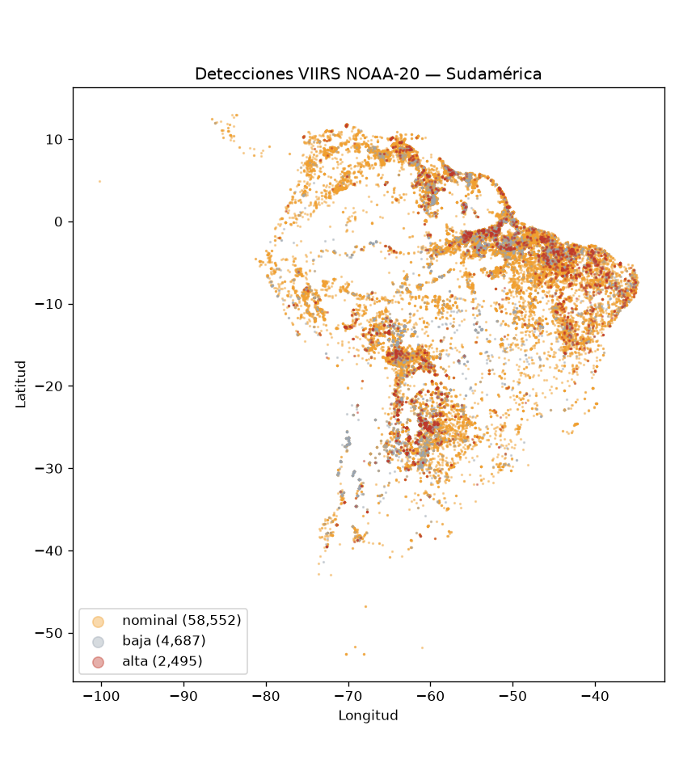
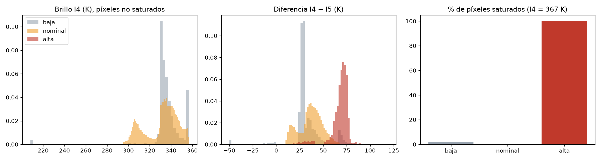
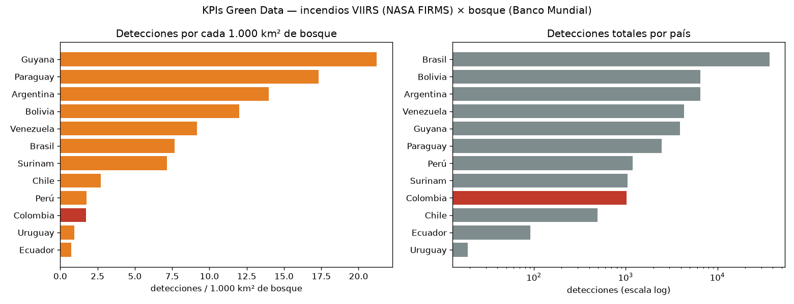
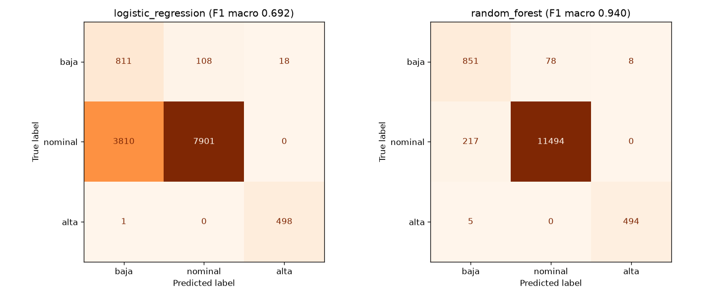
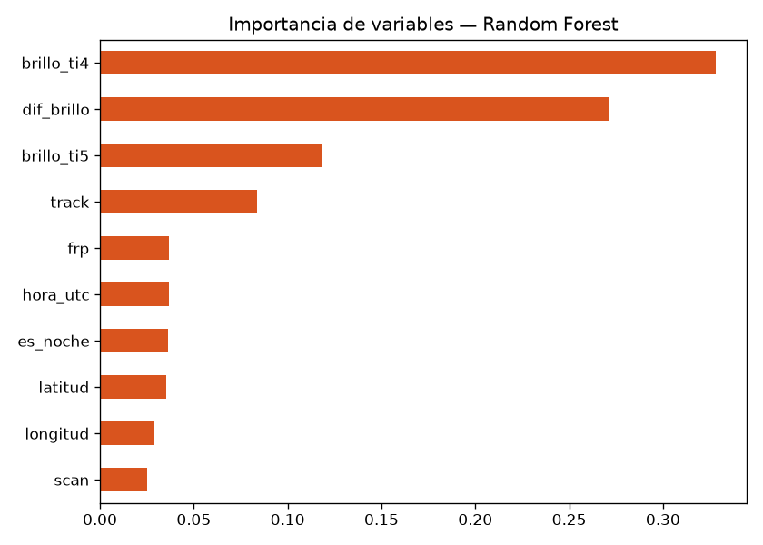

# Reporte final — Green Data: incendios forestales (NASA FIRMS) y bosque (Banco Mundial) con Apache Airflow

**Laboratorio 2:** ETL con arquitectura Medallion, orquestado con Apache Airflow, más CRISP-DM, TDSP y Scrum ML
**Curso:** Gestión de Proyectos de IA, Universidad Autónoma de Occidente
**Tema:** Green Data · **Fecha de ejecución:** 14 de noviembre de 2026 · **Entrega:** 21 de noviembre de 2026

---

## 1. Comprensión del negocio

Las autoridades ambientales y de gestión del riesgo vigilan los focos de calor detectados por satélite para priorizar la respuesta a incendios. En Colombia lo hacen el IDEAM, la UNGRD y las CAR. NASA publica estas detecciones casi en tiempo real en **FIRMS** (*Fire Information for Resource Management System*), un servicio de NASA Earthdata.

Contar incendios no basta para comparar países. Brasil siempre tendrá más detecciones porque es mucho más grande. La pregunta de negocio es:

> **¿Qué países de Sudamérica tienen la mayor presión del fuego sobre su bosque?**

Para responderla hay que **integrar dos fuentes**: las detecciones de incendio (API REST de FIRMS) y el área de bosque de cada país (archivo Excel del Banco Mundial).

**Objetivos:**

1. **Ingeniería de datos (eje del laboratorio):** construir un pipeline ETL reproducible y programado que extraiga ambas fuentes, las limpie, las integre con un JOIN y genere un dataset consolidado con KPIs (`gold_final.csv`). Debe estar orquestado con Airflow y tener supervisión de logs.
2. **Indicadores de negocio:** calcular por país las detecciones y la potencia del fuego (FRP) por cada 1.000 km² de bosque, la participación en el total y el porcentaje de alta confianza.
3. **Modelo (continuidad del Laboratorio 1):** clasificar el nivel de confianza de cada detección (baja, nominal o alta) a partir de sus variables radiométricas.
   - **Métrica:** F1 macro.
   - **Regla de decisión:** si el modelo complejo no supera al baseline por al menos 0,01 de F1, se prefiere el más simple.

## 2. Comprensión de los datos

### 2.1 Fuentes

| | Fuente 1 — API REST | Fuente 2 — Archivo Excel |
|---|---|---|
| Proveedor | NASA FIRMS (Earthdata) | Banco Mundial (datos de FAO) |
| Acceso | `requests` → API de área `/api/area/csv/{MAP_KEY}/VIIRS_NOAA20_NRT/{bbox}/{días}` (máx. 5 días por consulta); si no hay clave, feed público de 7 días | `pandas.read_excel` del archivo `API_AG.LND.FRST.K2…xls` (hoja `Data`) descargado de data.worldbank.org; hay copia de respaldo en el repositorio |
| Contenido | Una fila por detección: coordenadas, brillo I4/I5, FRP, confianza, fecha y hora, día/noche | Una fila por país con el área de bosque (km²) en columnas por año (1960–2025) |
| Volumen | 65.734 detecciones únicas (7–14 nov 2026) | 266 países y agregados; se usan los 12 de Sudamérica |
| Llave del JOIN | País asignado a cada punto con los límites de Natural Earth → `pais_iso3` | `Country Code` (ISO 3166 alfa-3) → `pais_iso3` |

**Fuente de apoyo:** límites de países de **Natural Earth 1:50m** (dominio público, GeoJSON). Permite saber en qué país cae cada detección, que es lo que hace posible el JOIN.

### 2.2 Detecciones (API)

| Aspecto | Resultado |
|---|---|
| Clases de confianza | nominal 58.552 (89,1 %) · baja 4.687 (7,1 %) · alta 2.495 (3,8 %) |
| Desbalance | ≈ 23:1 |
| Día / noche | 69,5 % / 30,5 % |
| FRP (MW) | mediana 5,4 · media 10,1 · máx. 770,2 (muy sesgada) |
| Nulos en columnas clave | 0 |

**Hallazgos del análisis exploratorio:**

- **El 100 % de las detecciones de confianza "alta" tiene el canal I4 saturado (367 K)** y ninguna "nominal" lo está. Esto coincide con el algoritmo VIIRS: un píxel saturado se marca como confianza alta.
- **La confianza "baja" solo aparece de día** (0 % nocturnas): el algoritmo la asigna a anomalías diurnas débiles y a zonas con reflejo solar.

### 2.3 Bosque (Excel)

- El archivo viene en **formato ancho**, con una columna por año, e incluye agregados como "World" o "Latin America & Caribbean". También tiene años vacíos.
- El último año con dato para los 12 países es **2025**. Los valores de los años más recientes provienen de las series de la FAO, que el Banco Mundial extiende con estimaciones.
- Las áreas van de 20.240 km² (Uruguay) a 4,86 millones de km² (Brasil).

## 3. Preparación de los datos — pipeline Medallion

| Capa | Qué se hace | Código |
|---|---|---|
| **Bronze** | Cada descarga se guarda **sin modificar** con su origen y la fecha y hora en el nombre: `firms_viirs_noaa20_api_<UTC>.csv` y `bosque_banco_mundial_descarga_<UTC>.xls`. Si no se puede descargar el Excel, se usa la copia de respaldo y el nombre lo indica. | `src/extract/extract_firms.py`, `src/extract/extract_excel.py` |
| *Validación* | **API:** columnas requeridas, mínimo 100 filas, coordenadas en rango. **Excel:** estructura del Banco Mundial, indicador `AG.LND.FRST.K2` y presencia de los 12 países. Si algo falla, el DAG se detiene y no contamina las capas siguientes. | `src/transform/validate_bronze.py` |
| **Silver — detecciones** | Une todos los snapshots y normaliza la confianza (`l/n/h` y `low/nominal/high` → `baja/nominal/alta`). Construye `fecha_hora_utc`, elimina nulos y valores imposibles, **deduplica** por `(lat, lon, fecha_hora, satélite)` y ordena por `id_deteccion` para que sea reproducible. | `src/transform/clean_firms.py` |
| **Silver — bosque** | Pasa el Excel de ancho a largo (`melt`). Normaliza tipos, filtra los 12 países, elimina nulos, valores ≤ 0 y duplicados, y toma el **último año disponible** por país. | `src/transform/integrar_fuentes.py` |
| **Silver — JOIN** | Asigna a cada detección su país (consulta espacial con `shapely`: punto dentro del polígono) y hace un **LEFT JOIN** con el bosque por `pais_iso3` (`validate="many_to_one"`). Resultado: `silver_integrado.csv`. | `src/transform/integrar_fuentes.py` |
| **Gold** | **`gold_final.csv`** con los KPIs por país; detecciones con variables derivadas (`dif_brillo`, `hora_utc`, `es_noche`, celda de 1°, `en_region_interes`); resumen diario por celda. | `src/transform/gold_data.py` |
| **Almacén** | SQLite en estrella: `fact_detecciones`, `dim_pais`, `dim_fecha`, `kpi_pais` y `agg_diario_celda`. | `src/load/load_datawarehouse.py` |

**Resultado del JOIN:**

| | Detecciones | % |
|---|---|---|
| Con país de Sudamérica y dato de bosque | 64.781 | 98,5 % |
| En el mar o fuera de los límites (`SIN_PAIS`) | 647 | 1,0 % |
| Guayana Francesa (en Natural Earth figura como Francia) | 243 | 0,4 % |
| Centroamérica y Caribe, dentro de la caja de consulta | 63 | 0,1 % |

Estas 953 detecciones sin dato de bosque se conservan en Silver con `tiene_dato_bosque = 0`, pero no entran en los KPIs por país.

**Mejora colateral:** antes, "Colombia" era un rectángulo aproximado que contaba 1.805 detecciones e incluía parte de Venezuela, Ecuador y Brasil. Con el límite real del país son **1.026**.

**Idempotencia y reproducibilidad:**

- Bronze acumula **9 snapshots de la API (≈ 428 mil filas)** y Silver los consolida en **65.734 detecciones únicas**: volver a ejecutar el pipeline no duplica datos.
- Los mismos datos producen siempre la misma tabla Silver y las mismas métricas. Se verificó procesando dos veces en el contenedor: la tabla salió idéntica byte a byte.

## 4. Indicadores de negocio (`gold_final.csv`)

| KPI | Definición |
|---|---|
| `detecciones_por_1000km2_bosque` | detecciones ÷ área de bosque × 1.000 — **presión del fuego sobre el bosque** |
| `frp_por_1000km2_bosque` | potencia radiativa total (MW) ÷ área de bosque × 1.000 — intensidad relativa |
| `participacion_pct` | % de las detecciones de Sudamérica |
| `pct_alta_confianza`, `pct_nocturnas` | calidad e intensidad de las detecciones |
| `dias_con_fuego`, `celdas_afectadas` | persistencia temporal y extensión espacial (celdas de 1°) |
| `ranking_presion_bosque` | posición según la presión sobre el bosque |

| # | País | Bosque (km²) | Detecciones | Det./1.000 km² | FRP/1.000 km² (MW) | % total | % alta conf. | Celdas |
|---|---|---|---|---|---|---|---|---|
| 1 | Guyana | 183.772 | 3.897 | **21,21** | 180,6 | 6,0 | 2,4 | 23 |
| 2 | Paraguay | 142.974 | 2.477 | **17,32** | **231,3** | 3,8 | 4,6 | 48 |
| 3 | Argentina | 465.980 | 6.516 | 13,98 | 198,5 | 10,1 | 7,1 | 157 |
| 4 | Bolivia | 543.703 | 6.529 | 12,01 | 118,2 | 10,1 | 4,6 | 85 |
| 5 | Venezuela | 470.882 | 4.307 | 9,15 | 67,4 | 6,7 | 2,8 | 79 |
| 6 | Brasil | 4.860.866 | 37.191 | 7,65 | 75,5 | **57,4** | 3,5 | 622 |
| 7 | Surinam | 146.742 | 1.048 | 7,14 | 54,2 | 1,6 | 1,1 | 15 |
| 8 | Chile | 181.619 | 495 | 2,73 | 18,9 | 0,8 | 2,6 | 38 |
| 9 | Perú | 671.598 | 1.185 | 1,76 | 22,8 | 1,8 | 3,8 | 92 |
| 10 | **Colombia** | 594.569 | 1.026 | 1,73 | 10,4 | 1,6 | 1,5 | 74 |
| 11 | Uruguay | 20.240 | 19 | 0,94 | 5,8 | 0,03 | 5,3 | 10 |
| 12 | Ecuador | 123.103 | 91 | 0,74 | 4,2 | 0,1 | 1,1 | 14 |

**Lectura para la toma de decisiones:**

- **Brasil concentra el 57 % de las detecciones**, pero por su enorme bosque su presión relativa es intermedia (7,7 por 1.000 km²).
- **Guyana (21,2) y Paraguay (17,3)** tienen la mayor presión del fuego sobre su bosque. Paraguay además registra la mayor intensidad (231 MW por 1.000 km²): sus incendios son menos numerosos pero más potentes.
- **Argentina** tiene el mayor porcentaje de detecciones de alta confianza (7,1 %), es decir, la mayor proporción de fuegos intensos.
- **Colombia** está entre los países con menor presión de la semana (1,7 por 1.000 km²), con 1.026 detecciones repartidas en 74 celdas.

*Advertencia:* son 8 días de noviembre. La presión del fuego es muy estacional, así que estos KPIs describen la semana analizada y no un promedio anual. Con la ejecución diaria del DAG, el histórico crece y los KPIs se recalculan solos.

## 5. Modelado y evaluación

| Modelo | Configuración | Rol |
|---|---|---|
| Regresión logística | `StandardScaler` + `LogisticRegression(max_iter=2000, class_weight="balanced")` | Baseline |
| Random Forest | 200 árboles, `class_weight="balanced"` | Alternativo |

**Variables de entrada (10):** `brillo_ti4`, `brillo_ti5`, `dif_brillo`, `frp`, `scan`, `track`, `es_noche`, `hora_utc`, `latitud`, `longitud`.
**Partición:** 80/20 estratificada, `random_state=42`, con 52.587 detecciones para entrenamiento y 13.147 para prueba.

| Modelo | Accuracy | F1 macro | CV F1 macro (3 folds) |
|---|---|---|---|
| Regresión logística | 0,701 | 0,692 | 0,693 ± 0,003 |
| **Random Forest** | **0,977** | **0,940** | **0,938 ± 0,002** |

| Clase (precisión / recall / F1) | Regresión logística | Random Forest |
|---|---|---|
| baja | 0,18 / 0,87 / 0,29 | 0,79 / 0,91 / **0,85** |
| nominal | 0,99 / 0,67 / 0,80 | 0,99 / 0,98 / **0,99** |
| alta | 0,97 / 1,00 / 0,98 | 0,98 / 0,99 / **0,99** |

**Análisis de errores:**

- **Regresión logística:** clasifica 3.810 detecciones nominales como "baja" (precisión de 0,18 en esa clase). La frontera entre baja y nominal no es lineal.
- **Random Forest:** reduce esa confusión a 217 casos. La clase alta se acierta en el 99 % de los casos.

Las variables más útiles son `brillo_ti4` (0,33), `dif_brillo` (0,27) y `brillo_ti5` (0,12).

**Decisión:** el Random Forest supera al baseline por **+0,249 de F1 macro**, así que **se recomienda el Random Forest**. Es lo opuesto al Laboratorio 1, donde los modelos empataron.

**Interpretación honesta:** la confianza la calcula el propio algoritmo de NASA con estas mismas variables. Por eso el modelo, en gran parte, *reaprende sus reglas* ("I4 saturado → alta"). Su valor práctico es comprobar que los datos que entrega el pipeline son coherentes con la física del sensor.

## 6. Despliegue, orquestación y supervisión de logs (TDSP)

- **Airflow 3.3.2** en Docker Compose (api-server, scheduler, dag-processor, worker Celery, triggerer, Postgres y Redis), con una imagen propia que incluye pandas, scikit-learn, shapely, xlrd y openpyxl.
- El proyecto se monta en el contenedor en `/opt/airflow/incendios_etl`.
- **DAG `incendios_firms_medallion`** con 7 tareas. Las dos extracciones corren **en paralelo**: `[extraer_firms, extraer_excel_bosque] >> validar_bronze >> transformar_a_silver >> integrar_a_gold >> cargar_datawarehouse >> entrenar_modelo`. Corre a diario a las 06:00 UTC, con `catchup=False` y 2 reintentos por tarea.
- **Supervisión de logs:** cada tarea deja en el log de Airflow lo que hizo. Ejemplos:
  - `Excel de bosque guardado en Bronze (descarga del Banco Mundial)`
  - `Silver: 65,734 detecciones únicas; bosque de 12 países; JOIN: 64,781 detecciones con dato de bosque (98.5%)`
  - `Gold: … gold_final.csv con KPIs de 12 países`

  Si una tarea falla, su log muestra el error, por ejemplo una columna faltante o un indicador inesperado.

**Evidencia de ejecución:**

| Ejecución | Descripción | Estado |
|---|---|---|
| `manual__2026-11-14T19:47:47` | primera ejecución (feed público) | success |
| `manual__2026-11-14T19:49:11` | prueba de idempotencia | success |
| `scheduled__2026-11-14T06:00:00` | programada | success |
| `manual__2026-11-14T19:50:48` | gráficas ajustadas | success |
| `manual__2026-11-14T20:42:57` | primera con la API (MAP_KEY) | success |
| `manual__2026-11-14T20:57:34` | lanzada por el script de arranque | success |
| `manual__2026-11-14T21:05:28` | orden reproducible | success |
| `manual__2026-11-14T21:15:40` | **primera con las dos fuentes y el JOIN** | success |
| `manual__2026-11-14T21:17:18` | corrección de formato de `gold_final` | success |

- **Pruebas:** `tests/test_pipeline.py` tiene **12 pruebas**, todas aprobadas. Cubren:
  - limpieza, deduplicación y reproducibilidad de Silver;
  - limpieza del Excel (último año, filtro de países, nulos);
  - JOIN y asignación de país, incluido un punto en el mar;
  - validación del Excel, KPIs, carga del almacén y manejo de la API.

## 7. Limitaciones y trabajo futuro

- **Ventana corta:** son 8 días de datos. La API admite consultas por fecha, así que encadenando consultas de 5 días se podría cargar una temporada completa y analizar la estacionalidad.
- **Bosque anual y estimado:** el área de bosque es un dato anual y los años recientes son estimaciones. Una mejora sería usar cobertura del suelo satelital (por ejemplo, MODIS Land Cover) para saber si cada incendio ocurrió *dentro* de un bosque.
- **Guayana Francesa:** queda fuera porque Natural Earth la incluye dentro de Francia. Se podría añadir con su propio polígono.
- **Objetivo de modelo con más valor:** predecir la **persistencia del fuego** por celda (PB-13), aprovechando el resumen diario de Gold.
- **Almacén:** en producción se cargaría a PostgreSQL usando una `Connection` de Airflow.
